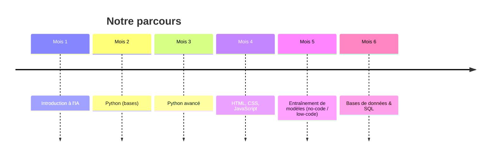
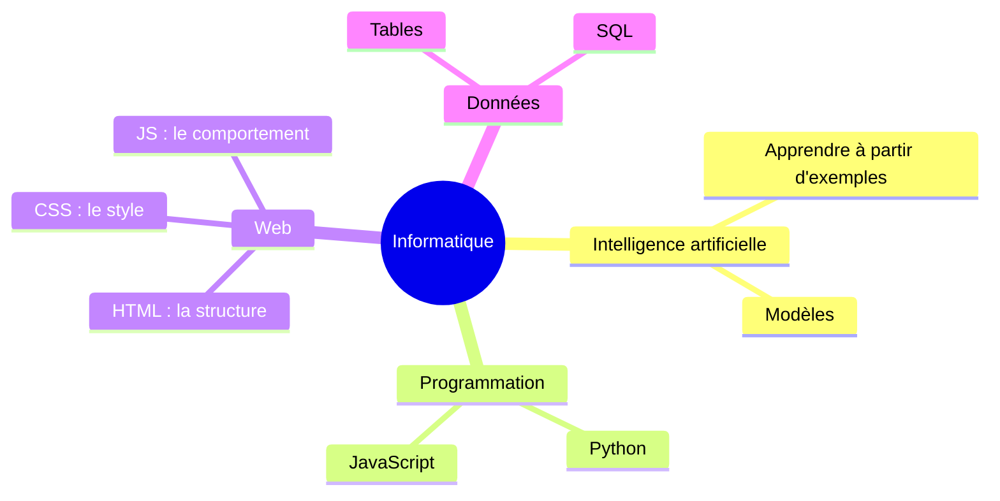
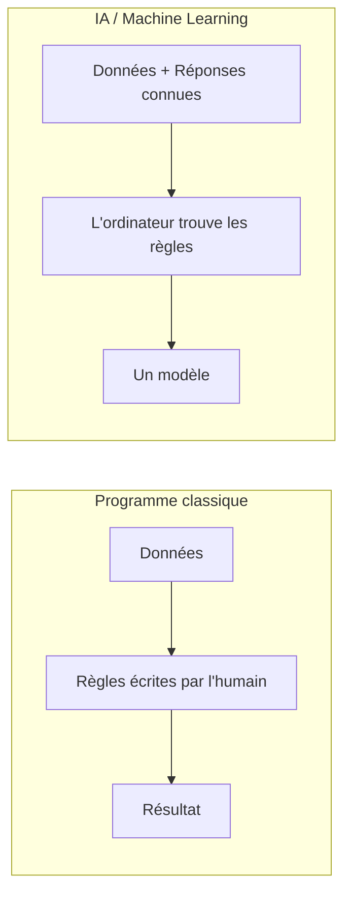
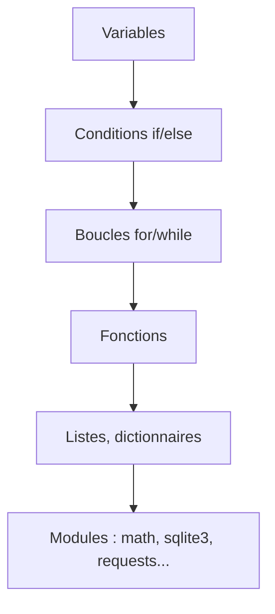
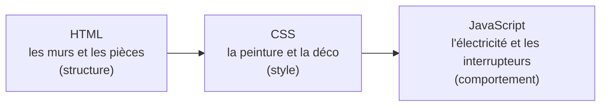
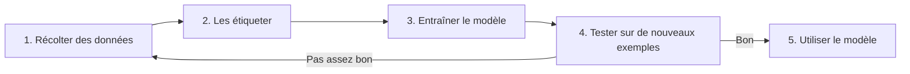
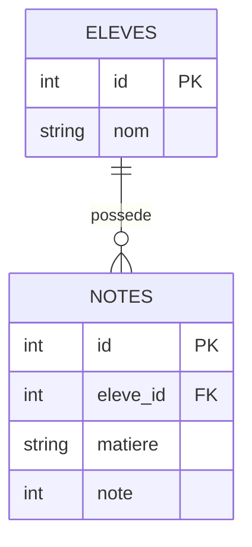
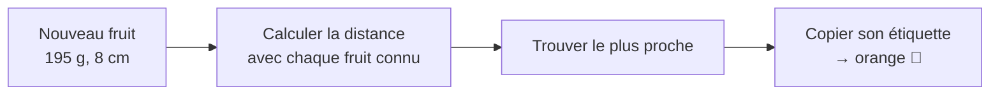

# 🚀 6 mois d'informatique : le grand récap + un projet final

**Élève :** Louis
**Durée :** 1h de rappel + pause + 45 min de projet
**Principe :** beaucoup de schémas, un mini-quiz après chaque partie, et un vrai projet à la fin.

---

## 🗺️ Plan de la séance

| Durée | Partie |
|---|---|
| 5 min | 0. Où en est-on ? La carte de nos 6 mois |
| 10 min | 1. L'intelligence artificielle |
| 10 min | 2. Python |
| 10 min | 3. HTML / CSS / JavaScript |
| 10 min | 4. Entraîner un modèle (no-code / low-code) |
| 10 min | 5. Bases de données & SQL |
| 5 min | 6. Quiz final de rappel |
| 5 min | ☕ Pause |
| 45 min | 🏆 **Projet : construire une mini-IA from scratch** |

---

## 0. La carte de nos 6 mois (5 min)





> 🗣️ **À demander à Louis :** "Parmi tout ça, qu'est-ce qui t'a le plus plu ? Qu'est-ce que tu as oublié ?" → ça te dit sur quoi insister.

---

## 1. L'intelligence artificielle (10 min)

### L'idée clé

Un programme classique suit des **règles écrites par un humain**.
Une IA **apprend les règles elle-même** à partir d'**exemples**.



### Le vocabulaire à retenir

| Mot | Sens simple |
|---|---|
| **Donnée** | Un exemple (une image, un nombre, un texte) |
| **Étiquette (label)** | La bonne réponse associée à un exemple |
| **Entraînement** | L'ordinateur regarde plein d'exemples pour apprendre |
| **Modèle** | Le "cerveau" obtenu à la fin de l'entraînement |
| **Prédiction** | La réponse que donne le modèle pour un nouvel exemple |

### ✅ Mini-quiz
1. Quelle est la différence entre un programme classique et une IA ?
2. C'est quoi une "étiquette" ? Donne un exemple.

---

## 2. Python (10 min)

### Les briques de base

```python
# Variables et types
age = 15            # nombre entier
nom = "Louis"       # texte
notes = [12, 15, 18]  # liste

# Condition
if age >= 18:
    print("Majeur")
else:
    print("Mineur")

# Boucle
for note in notes:
    print(note)

# Fonction
def moyenne(liste):
    return sum(liste) / len(liste)

print(moyenne(notes))
```



### 🔧 Défi express (3 min)
Écrire une fonction `maximum(liste)` qui renvoie le plus grand nombre **sans utiliser** `max()`.

<details>
<summary>💡 Solution (pour toi)</summary>

```python
def maximum(liste):
    plus_grand = liste[0]
    for x in liste:
        if x > plus_grand:
            plus_grand = x
    return plus_grand
```
</details>

### ✅ Mini-quiz
1. Quelle est la différence entre une liste et une variable simple ?
2. À quoi sert `return` dans une fonction ?

---

## 3. HTML / CSS / JavaScript (10 min)

### Les 3 rôles (l'analogie de la maison 🏠)



### Exemple minimal qui regroupe les trois

```html
<!DOCTYPE html>
<html>
<head>
  <style>
    button { background: royalblue; color: white; padding: 10px; border-radius: 8px; }
  </style>
</head>
<body>
  <h1 id="titre">Bonjour !</h1>
  <button onclick="changer()">Clique-moi</button>

  <script>
    function changer() {
      document.getElementById("titre").textContent = "Tu as cliqué ! 🎉";
    }
  </script>
</body>
</html>
```

### ✅ Mini-quiz
1. Quelle technologie sert à changer la couleur d'un bouton ? Et à réagir à un clic ?
2. C'est quoi une balise ? Cite-en trois.

### 🔧 Défi express (3 min)
Modifier le code ci-dessus pour que le bouton change aussi la couleur du titre en rouge.

---

## 4. Entraîner un modèle sans coder (10 min)

### Le cycle de vie d'un modèle



### Les pièges à connaître

| Problème | Explication simple |
|---|---|
| **Pas assez de données** | Le modèle a trop peu d'exemples pour bien apprendre |
| **Données biaisées** | Si on n'entraîne qu'avec des photos de chats noirs, il ne reconnaîtra pas les chats blancs |
| **Sur-apprentissage** | Le modèle "apprend par cœur" au lieu de comprendre : parfait sur l'entraînement, nul sur du nouveau |

### ✅ Mini-quiz
1. Pourquoi teste-t-on un modèle sur des données qu'il n'a **jamais vues** ?
2. Si un modèle a 100 % de réussite à l'entraînement mais 40 % en test, que s'est-il passé ?

---

## 5. Bases de données & SQL (10 min)

### Le schéma à retenir



### Les 4 commandes essentielles

```sql
SELECT nom FROM eleves WHERE classe = '1ère A';   -- lire
INSERT INTO eleves (nom) VALUES ('Emma');          -- ajouter
UPDATE notes SET note = 15 WHERE id = 2;           -- modifier
DELETE FROM notes WHERE id = 5;                    -- supprimer
```

### ✅ Mini-quiz
1. C'est quoi une clé primaire ? Une clé étrangère ?
2. Pourquoi ne fait-on jamais `DELETE` sans `WHERE` ?

---

## 6. Quiz final de rappel (5 min)

*(À l'oral, rapide, sans note.)*

1. Cite 3 types de choses qu'on peut construire avec Python.
2. HTML, CSS, JS : un mot pour chacun.
3. Cite les 4 étapes pour entraîner un modèle d'IA.
4. À quoi sert un `JOIN` en SQL ?
5. Quelle partie du programme t'a le plus plu, et pourquoi ?

---

## ☕ Pause (5 min)

---

# 🏆 PROJET : construire une mini-IA *from scratch* (45 min)

> **Pourquoi ce projet ?** Louis a déjà entraîné des modèles avec des interfaces "no-code". Aujourd'hui, il va **ouvrir la boîte** et comprendre ce qu'il se passe dedans, en n'utilisant que du Python et des maths qu'il connaît déjà (Pythagore !).

## L'idée : l'algorithme des "plus proches voisins" (k-NN)

On veut que l'ordinateur devine si un fruit est une **pomme** ou une **orange**, à partir de son **poids** et de sa **taille**.

**Principe :** pour un nouveau fruit, on regarde **le fruit connu le plus proche** et on copie sa réponse.



La **distance** entre deux points, c'est le théorème de Pythagore :

```
distance = √( (poids₁ − poids₂)² + (taille₁ − taille₂)² )
```

## Étape 1 : les données (5 min)

```python
import math

# (poids en g, taille en cm, étiquette)
donnees = [
    (150, 7.0, "pomme"),
    (160, 7.5, "pomme"),
    (140, 6.8, "pomme"),
    (200, 8.0, "orange"),
    (210, 8.5, "orange"),
    (190, 7.8, "orange"),
]
```

✅ **Question :** Si on dessine ces fruits sur un graphique (poids en x, taille en y), à quoi ressemblent les deux groupes ?

## Étape 2 : la distance (10 min)

```python
def distance(a, b):
    return math.sqrt((a[0] - b[0])**2 + (a[1] - b[1])**2)

print(distance((150, 7.0), (200, 8.0)))
```

🔧 **À faire :** Louis calcule d'abord à la main la distance entre `(150, 7.0)` et `(200, 8.0)`, puis vérifie avec Python.

## Étape 3 : la prédiction (15 min)

```python
def predire(nouveau, donnees):
    meilleur = None
    plus_petite = float("inf")  # "infini" : n'importe quelle distance sera plus petite

    for poids, taille, etiquette in donnees:
        d = distance(nouveau, (poids, taille))
        if d < plus_petite:
            plus_petite = d
            meilleur = etiquette

    return meilleur

print(predire((195, 8.0), donnees))   # → orange
print(predire((145, 7.1), donnees))   # → pomme
```

🔧 **À faire :** Louis invente 3 fruits "mystères", fait deviner l'ordinateur, et vérifie si la réponse paraît logique.

## Étape 4 : améliorer avec k voisins (10 min)

Un seul voisin, c'est fragile (et si c'était une erreur dans les données ?). On regarde **les k plus proches** et on **vote**.

```python
from collections import Counter

def predire_k(nouveau, donnees, k=3):
    # Liste de (distance, étiquette) pour tous les fruits connus
    distances = []
    for poids, taille, etiquette in donnees:
        d = distance(nouveau, (poids, taille))
        distances.append((d, etiquette))

    distances.sort()                     # du plus proche au plus loin
    k_plus_proches = distances[:k]       # on garde les k premiers

    votes = Counter(etiquette for d, etiquette in k_plus_proches)
    return votes.most_common(1)[0][0]    # l'étiquette la plus fréquente

print(predire_k((195, 8.0), donnees, k=3))
```

✅ **Question :** Pourquoi voter à plusieurs est-il plus fiable qu'un seul voisin ? (À relier à la notion de sur-apprentissage vue plus tôt.)

## Étape 5 : bonus, tester sa mini-IA (5 min)

Séparer les données en deux : **entraînement** et **test**, comme avec les modèles no-code.

```python
entrainement = donnees[:4]   # à adapter pour garder des pommes ET des oranges
test = donnees[4:]

bonnes = 0
for poids, taille, vraie_etiquette in test:
    if predire_k((poids, taille), entrainement, k=1) == vraie_etiquette:
        bonnes += 1

print(f"Réussite : {bonnes}/{len(test)}")
```

## 🎓 Ce que Louis doit retenir

- Une IA, ce n'est pas de la magie : ici c'est **des distances + une comparaison**.
- Ce qu'il a utilisé dans ce projet : **Python** (fonctions, boucles, listes), **maths** (Pythagore), **concepts d'IA** (données, étiquettes, entraînement, test).
- Les "vrais" modèles font la même chose en beaucoup plus gros (millions d'exemples, centaines de dimensions au lieu de 2).

---

## 🔭 Si tu as encore du temps / idées pour la suite

| Idée | Lien avec ce qu'il connaît | Difficulté |
|---|---|---|
| Afficher les fruits sur un **graphique** (`matplotlib`) | Python + maths | ⭐⭐ |
| Stocker les fruits dans une **base SQLite** et lire les données depuis la BDD | SQL + Python | ⭐⭐ |
| Faire une **page web** où on tape poids/taille et la prédiction s'affiche (JavaScript) | HTML/CSS/JS + IA | ⭐⭐⭐ |
| Passer à 3 caractéristiques (ex : couleur codée en nombre) | Maths (distance en 3D) | ⭐⭐ |

---

## 📝 Notes pour l'enseignant

- **Rythme :** Louis comprend très vite. Si le rappel (parties 1 à 5) passe plus vite que prévu, enchaîner directement sur le projet pour garder plus de temps pour les étapes 4 et 5, qui sont les plus riches.
- **Le rappel sert de diagnostic :** note les parties où Louis hésite lors des mini-quiz, et reviens dessus dans la partie centrale de la séance.
- **Adapter le langage** selon son âge : tous les schémas et analogies (maison, annuaire, etc.) fonctionnent aussi bien avec un élève jeune qu'avec un lycéen.
